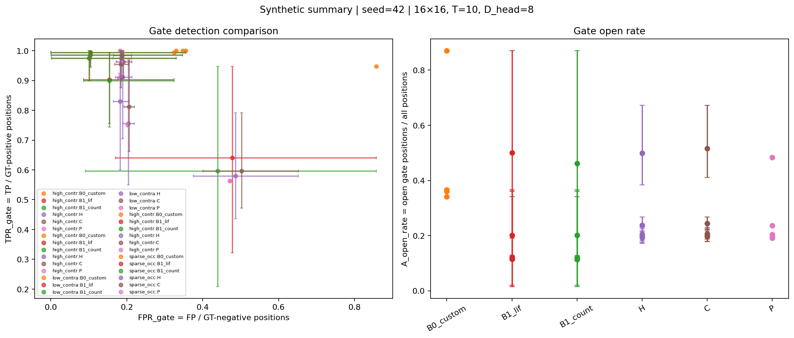

# P2 合成动态视觉探测——结果与机制分析

> **证据边界：** 合成探测在二值 query 脉冲 $Q \in \{0,1\}^{T \times B \times heads \times D_{head} \times (HW)}$ 上测试可控动态模式，以刻画门控机制（`B0`、`B1`、`H`、`C`、`P`）。这些实验**不能**证明其可泛化到真实视觉数据集，也不能证明下游分类准确率。

## 1. 实验配置

- **生成器与运行器：** `research_qkta/synthetic_probe.py`（`run_synthetic_suite`），配置为 `configs/research_qkta/synthetic.yaml`。
- **尺寸：** `H = 16`、`W = 16`（`N = 256` 个 token）、`T = 10` 个时间步、`B = 1`、`heads = 1`、`D_head = 8`。
- **基础随机种子与模式种子：** `base_seed = 42`；各模式种子为 `42..47`（`42 + pattern_idx`）。
- **门控参数：**
  - `B0_original`、`B0_custom`：`tau = 2.0, theta0 = 0.5, b = 0.0`。
  - `B1_count`：`k_thresh in {1, 2, 3, 4}`（无记忆整数阈值）。
  - `B1_lif`：`tau = 2.0, theta0 in {0.5, 1.0, 1.5, 2.0}`（标准 LIF）。
  - `H`：`tau = 2.0, theta0 = 0.5, rho = 0.5, eta = 0.0, b in {0.5, 1.0, 2.0, 3.0, 4.0}`。
  - `C`：`tau = 2.0, theta0 = 0.5, rho = 0.5, eta = 0.5, kappa = 1.0, b in {0.5, 1.0, 2.0, 3.0, 4.0}`。
  - `P`：参数与 `C` 相同，`b in {1.0, 2.0, 3.0}`；对每个 `(t, b, head)` 使用 `perm_seeds = (101, 202, 303)` 对 `c` 做空间置换。
- **输出材料：** CSV `synthetic_results.csv`、JSON `synthetic_results.json`、时间轨迹 `synthetic_traces.npz`。

### 汇总图

## 2. 按模式汇总的定量结果（含原始分子和分母）

指标定义：

- `TPR_gate = tpr_num / tpr_den = sum(A * GT) / sum(GT)`；若 `GT` 全为 0，则为 `N/A (0/0)`。
- `FPR_gate = fpr_num / fpr_den = sum(A * (1 - GT)) / sum(1 - GT)`。
- `A_open_rate = a_open_count / a_total_count = sum(A) / (T * B * heads * H * W)`；`a_total_count = 2560`。

### 2.1 `low_contrast_persistent_bg`（`seed = 42`，`GT = 0`，`q_sum_mean = 1.7695`，`q_nonzero_fraction = 0.8590`）

**观察：** 在 `b=4.0` 时，历史抑制（`H`）将持续背景的开启率从 `0.8590`（`2199/2560`）降至 `0.3770`（`965/2560`）。整数通道计数的随机波动偶尔会超过 `kappa=1.0`（`c_active_rate=0.2340`），因此 `C` 比 `H` 多放行少量背景（`b=2..4` 时 FPR 高 `+0.0207` 至 `+0.0328`）。

### 2.2 `high_contrast_moving_target`（`seed = 43`，`gt_pos = 0.0156`，`q_sum_mean = 0.5078`）

在 `b=2.0` 时，`H` 和 `C` 的目标 TPR 均为 `1.0000`；随着抑制增强，`b=4.0` 时 `H` 的 TPR 为 `0.9000`，`C` 为 `0.9500`。`C` 的背景 FPR 略高；3 个种子的 `P_b3.0` 平均 TPR 为 `0.9917`。

### 2.3 `high_contrast_static_target`（`seed = 46`，`gt_pos = 0.0156`，`q_sum_mean = 0.4781`）

**观察：** 该模式用于检验核心机制假设。随着 `R` 累积，`H` 会错误抑制静止目标（TPR 在 `b=3.0` 降至 `0.6500`，在 `b=4.0` 降至 `0.6000`）；`C` 分别保持 `0.9250` 和 `0.8750`，比 `H` 高 `+0.2750`，FPR 代价仅为 `+0.0024` 至 `+0.0032`。`b=3.0` 时空间置换 `P` 的 TPR 均值降至 `0.6750`，说明空间对齐的 `c` 是保护效果的关键。

### 2.4 `sparse_occluded_reappearing_target`（`seed = 47`，`gt_pos = 0.0211`，`q_sum_mean = 0.5242`）

`b=3.0` 时，`H` 的 TPR 为 `0.8889`，`C` 为 `0.9444`；`P` 三种子平均为 `0.9074`。在遮挡阶段，`R` 会衰减；目标于 `t=7` 重现时，`H_b3.0` 和 `C_b3.0` 都立即恢复到 `per_step_tpr[7] = 1.0`。

### 2.5 反例一：`high_contrast_flickering_noise`（`seed = 44`，`gt_pos = 0.0625`，`q_sum_mean = 1.0895`）

**失效分析：** 独立的 `1x1` 闪烁背景脉冲具有较低的 8 邻域均值 `q_bar` 和较高的 `q`，所以 `q - q_bar >= kappa` 会令 `c=1`（`c_active_rate=0.1492`）。因此 `C` 会错误保护背景噪声，在所有 `b>=1.0` 时均有 `FPR_C > FPR_H`（例如 `b=2.0` 时为 `491/2400` 对 `481/2400`）。简单固定阈值控制表现更好：`B1_count_k3` 的 TPR/FPR 为 `0.9000/0.0875`，`B1_lif_theta1.5` 为 `0.9000/0.0879`，两者的目标保留率更高、背景泄漏更低。

### 2.6 反例二：`low_contrast_true_target`（`seed = 45`，`gt_pos = 0.1406`，`q_sum_mean = 1.8766`）

**失效分析：** `6x6` 目标与背景对比度较低（`p_fg = 0.30` 对 `p_bg = 0.22`），目标内部 token 的 `q - q_bar ≈ 0 < kappa = 1.0`，所以 `c=0`。因此 `C` 与 `H` 类似，会过度抑制真实目标（`b=2.0` 时 `TPR_C=0.5611`，`TPR_H=0.5472`），远低于 `B0` 的 `0.9472`；`P`（`0.5630`）与 `C` 几乎无差别。

## 3. 时间动态（`per_step_open_rate`、`R_trace_mean`、`theta_trace_mean`）

- **`high_contrast_static_target`（`b=3.0`）：** `B0_custom` 的逐步 TPR 始终为 1，`theta_trace_mean` 恒为 0.5。`H_b3.0` 的逐步 TPR 在 `[1.0, 0.75, 0.5, 0.75, 0.75, 0.25, 0.75, 0.75, 0.5, 0.5]` 间波动；`R_trace_mean` 从 `t=0` 的 0 上升到 `t=1` 的 0.1777，`theta_trace_mean` 在 `t=2` 升至 1.0947。`C_b3.0` 的 TPR 多数时间步恢复为 1，阈值轨迹较低（开头为 `[0.5, 1.0098, 1.0581, ...]）。
- **`sparse_occluded_reappearing_target`（`b=3.0`）：** 遮挡阶段（`t=3..6`），`H_b3.0` 的 `R_trace_mean` 从 0.2070 降至 0.1338；`C_b3.0` 从 0.2158 降至 0.1378。两者的阈值轨迹随之下降，并在目标于 `t=7` 重现时立即恢复到满 TPR。

## 4. 主要结论与校准建议

1. `B0_original`、`B0_custom`、`B1_count_k1` 和 `B1_lif_theta0.5` 在全部 6 种模式中逐位一致，确认基线等价。
2. 对紧凑且高对比度的目标（静态目标、遮挡后重现目标），`C`（`eta=0.5, kappa=1.0`）明显减轻 `H` 对目标的错误抑制；静态目标 `b=3,4` 时 TPR 高 `+0.2750`，并优于 3 种子 `P`（`0.9250` 对 `0.6750`），说明空间对应关系在这些情形中具有因果作用。
3. 两类失效符合理论预测：局部对比度 `c` 不理解语义，因此会错误保护孤立的 `1x1` 闪烁噪声，也无法保护大型低对比度目标。
4. P4 冻结模型校准时，可扫描 `b in {0.5, 1.0, 2.0, 3.0, 4.0}`（`eta=0.5, kappa=1.0, rho=0.5`），覆盖从接近 `B0`（`b=0.5`）到强历史抑制（`b=3.0,4.0`）的区间，使 `C` 与 `H` 的差异更加明显。

## 附录：各视觉模式的完整定量表格

表中配置名及各实验测量值沿用原始记录。

### 持续低对比度背景
| 配置 | `门控 TPR` (`分子/分母`) | `门控 FPR` (`分子/分母`) | `A 开启率` (`分子/分母`) | `c 激活率` |
| --- | --- | --- | --- | --- |
| `B0_original` / `B0_custom` | `N/A (0/0)` | `0.8590 (2199/2560)` | `0.8590 (2199/2560)` | `0.0000` |
| `B1_count_k2` / `B1_lif_theta1.0` | `N/A (0/0)` | `0.5582 (1429/2560)` | `0.5582 (1429/2560)` | `0.0000` |
| `B1_count_k3` | `N/A (0/0)` | `0.2578 (660/2560)` | `0.2578 (660/2560)` | `0.0000` |
| `B1_lif_theta1.5` | `N/A (0/0)` | `0.3395 (869/2560)` | `0.3395 (869/2560)` | `0.0000` |
| `H_b1.0` / `H_b2.0` / `H_b3.0` / `H_b4.0` | `N/A (0/0)` | `0.5410 (1385/2560)` / `0.4516 (1156/2560)` / `0.4082 (1045/2560)` / `0.3770 (965/2560)` | same as FPR | `0.0000` |
| `C_b1.0` / `C_b2.0` / `C_b3.0` / `C_b4.0` | `N/A (0/0)` | `0.5445 (1394/2560)` / `0.4758 (1218/2560)` / `0.4410 (1129/2560)` / `0.3977 (1018/2560)` | same as FPR | `0.2340` |
| `P_b2.0` (3 seeds mean [min, max]) | `N/A (0/0)` | `0.4702 [0.4684, 0.4719]` | `0.4702` | `0.2340` |

### 高对比度移动目标
| 配置 | `门控 TPR` (`分子/分母`) | `门控 FPR` (`分子/分母`) | `A 开启率` (`分子/分母`) | `c 激活率` |
| --- | --- | --- | --- | --- |
| `B0_original` / `B0_custom` | `1.0000 (40/40)` | `0.3556 (896/2520)` | `0.3656 (936/2560)` | `0.0000` |
| `B1_count_k3` | `1.0000 (40/40)` | `0.0052 (13/2520)` | `0.0207 (53/2560)` | `0.0000` |
| `B1_lif_theta1.5` | `1.0000 (40/40)` | `0.0075 (19/2520)` | `0.0230 (59/2560)` | `0.0000` |
| `H_b2.0` / `H_b3.0` / `H_b4.0` | `1.0000 (40/40)` / `0.9750 (39/40)` / `0.9000 (36/40)` | `0.1810 (456/2520)` / `0.1702 (429/2520)` / `0.1639 (413/2520)` | `0.1938` / `0.1828` / `0.1754` | `0.0000` |
| `C_b2.0` / `C_b3.0` / `C_b4.0` | `1.0000 (40/40)` / `0.9750 (39/40)` / `0.9500 (38/40)` | `0.1869 (471/2520)` / `0.1730 (436/2520)` / `0.1655 (417/2520)` | `0.1996` / `0.1855` / `0.1777` | `0.0828` |
| `P_b3.0` (3 seeds mean [min, max]) | `0.9917 [0.9750, 1.0000]` | `0.1712 [0.1702, 0.1718]` | `0.1840` | `0.0828` |

### 高对比度静态目标
| 配置 | `门控 TPR` (`分子/分母`) | `门控 FPR` (`分子/分母`) | `A 开启率` (`分子/分母`) | `c 激活率` |
| --- | --- | --- | --- | --- |
| `B0_original` / `B0_custom` | `1.0000 (40/40)` | `0.3302 (832/2520)` | `0.3406 (872/2560)` | `0.0000` |
| `B1_count_k3` | `1.0000 (40/40)` | `0.0063 (16/2520)` | `0.0219 (56/2560)` | `0.0000` |
| `B1_lif_theta2.0` | `0.9000 (36/40)` | `0.0016 (4/2520)` | `0.0156 (40/2560)` | `0.0000` |
| `H_b1.0` / `H_b2.0` / `H_b3.0` / `H_b4.0` | `1.0000 (40/40)` / `0.9000 (36/40)` / `0.6500 (26/40)` / `0.6000 (24/40)` | `0.1925 (485/2520)` / `0.1786 (450/2520)` / `0.1698 (428/2520)` / `0.1647 (415/2520)` | `0.2051` / `0.1898` / `0.1773` / `0.1715` | `0.0000` |
| `C_b1.0` / `C_b2.0` / `C_b3.0` / `C_b4.0` | `1.0000 (40/40)` / `0.9750 (39/40)` / `0.9250 (37/40)` / `0.8750 (35/40)` | `0.1956 (493/2520)` / `0.1810 (456/2520)` / `0.1722 (434/2520)` / `0.1679 (423/2520)` | `0.2082` / `0.1934` / `0.1840` / `0.1789` | `0.0934` |
| `P_b2.0` (3 seeds mean [min, max]) | `0.9083 [0.9000, 0.9250]` | `0.1798 [0.1794, 0.1802]` | `0.1911` | `0.0934` |
| `P_b3.0` (3 seeds mean [min, max]) | `0.6750 [0.6500, 0.7000]` | `0.1706 [0.1702, 0.1710]` | `0.1785` | `0.0934` |

### 稀疏遮挡后重现目标
| 配置 | `门控 TPR` (`分子/分母`) | `门控 FPR` (`分子/分母`) | `A 开启率` (`分子/分母`) | `c 激活率` |
| --- | --- | --- | --- | --- |
| `B0_original` / `B0_custom` | `1.0000 (54/54)` | `0.3468 (869/2506)` | `0.3605 (923/2560)` | `0.0000` |
| `H_b2.0` / `H_b3.0` / `H_b4.0` | `0.9630 (52/54)` / `0.8889 (48/54)` / `0.7037 (38/54)` | `0.1868 (468/2506)` / `0.1728 (433/2506)` / `0.1700 (426/2506)` | `0.2031` / `0.1879` / `0.1812` | `0.0000` |
| `C_b2.0` / `C_b3.0` / `C_b4.0` | `0.9630 (52/54)` / `0.9444 (51/54)` / `0.9074 (49/54)` | `0.1891 (474/2506)` / `0.1756 (440/2506)` / `0.1716 (430/2506)` | `0.2055` / `0.1918` / `0.1871` | `0.0828` |
| `P_b3.0` (3 seeds mean [min, max]) | `0.9074 [0.8889, 0.9259]` | `0.1735 [0.1732, 0.1740]` | `0.1889` | `0.0828` |

### 反例一：高对比度闪烁噪声
| 配置 | `门控 TPR` (`分子/分母`) | `门控 FPR` (`分子/分母`) | `A 开启率` (`分子/分母`) | `c 激活率` |
| --- | --- | --- | --- | --- |
| `B0_original` / `B0_custom` | `0.9938 (159/160)` | `0.3246 (779/2400)` | `0.3664 (938/2560)` | `0.0000` |
| `B1_count_k3` | `0.9000 (144/160)` | `0.0875 (210/2400)` | `0.1383 (354/2560)` | `0.0000` |
| `B1_lif_theta1.5` | `0.9000 (144/160)` | `0.0879 (211/2400)` | `0.1387 (355/2560)` | `0.0000` |
| `H_b2.0` / `H_b3.0` / `H_b4.0` | `0.7312 (117/160)` / `0.6062 (97/160)` / `0.5500 (88/160)` | `0.2004 (481/2400)` / `0.1942 (466/2400)` / `0.1900 (456/2400)` | `0.2336` / `0.2199` / `0.2125` | `0.0000` |
| `C_b2.0` / `C_b3.0` / `C_b4.0` | `0.7812 (125/160)` / `0.7250 (116/160)` / `0.6625 (106/160)` | `0.2046 (491/2400)` / `0.1963 (471/2400)` / `0.1925 (462/2400)` | `0.2406` / `0.2293` / `0.2219` | `0.1492` |
| `P_b2.0` (3 seeds mean [min, max]) | `0.7521 [0.7438, 0.7562]` | `0.2022 [0.2021, 0.2025]` | `0.2366` | `0.1492` |

### 反例二：低对比度真实目标
| 配置 | `门控 TPR` (`分子/分母`) | `门控 FPR` (`分子/分母`) | `A 开启率` (`分子/分母`) | `c 激活率` |
| --- | --- | --- | --- | --- |
| `B0_original` / `B0_custom` | `0.9472 (341/360)` | `0.8577 (1887/2200)` | `0.8703 (2228/2560)` | `0.0000` |
| `B1_count_k2` / `B1_lif_theta1.0` | `0.7583 (273/360)` | `0.5482 (1206/2200)` | `0.5777 (1479/2560)` | `0.0000` |
| `H_b1.0` / `H_b2.0` / `H_b3.0` / `H_b4.0` | `0.6417 (231/360)` / `0.5472 (197/360)` / `0.4806 (173/360)` / `0.4361 (157/360)` | `0.5382 (1184/2200)` / `0.4559 (1003/2200)` / `0.4114 (905/2200)` / `0.3755 (826/2200)` | `0.5527` / `0.4688` / `0.4211` / `0.3840` | `0.0000` |
| `C_b1.0` / `C_b2.0` / `C_b3.0` / `C_b4.0` | `0.6417 (231/360)` / `0.5611 (202/360)` / `0.5167 (186/360)` / `0.4722 (170/360)` | `0.5409 (1190/2200)` / `0.4786 (1053/2200)` / `0.4418 (972/2200)` / `0.4009 (882/2200)` | `0.5551` / `0.4902` / `0.4523` / `0.4109` | `0.2410` |
| `P_b2.0` (3 seeds mean [min, max]) | `0.5630 [0.5583, 0.5694]` | `0.4711 [0.4682, 0.4750]` | `0.4840` | `0.2410` |
