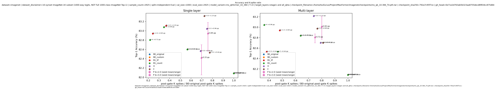
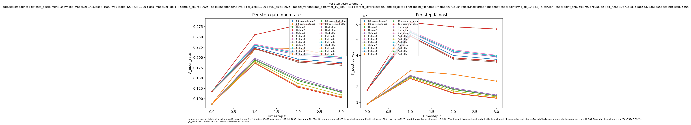
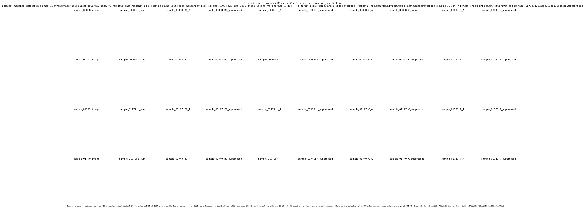
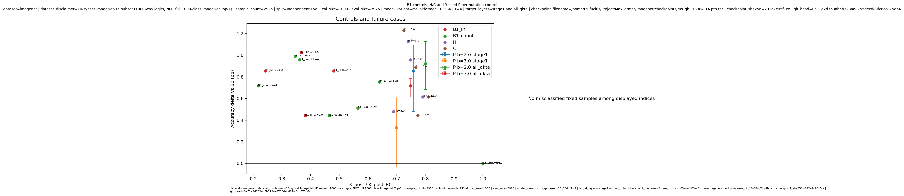
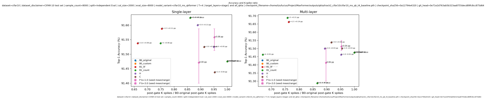
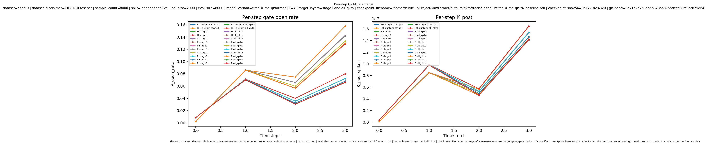
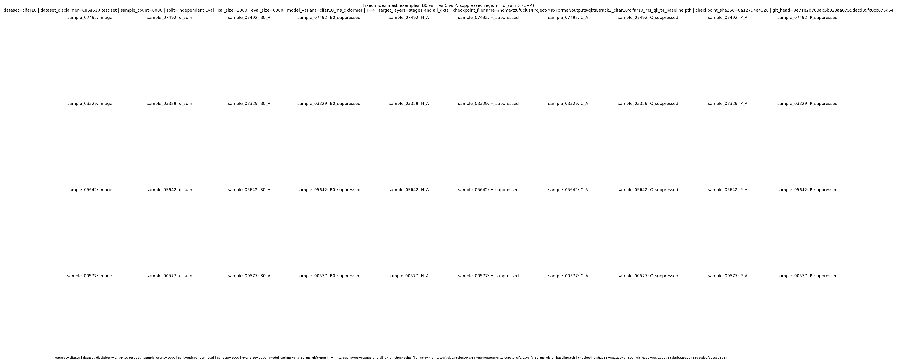
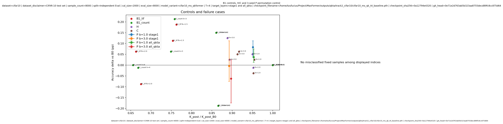

# P4 冻结推理消融实验与 Pareto 分析

## 1. 实验协议、指标定义与说明

- **预注册协议：** 固定冻结权重；每个 batch 前后都执行 `model.eval()`、`torch.no_grad()` 和 `functional.reset_net(model)`；`T = 4`，`seed = 42`。
- **盲校准锁定：** 在任何 `eval` 运行前，严格依据 `cal_results.csv` 锁定候选 `C` 的超参数（`tau=2.0, theta0=0.5, rho=0.5, eta=0.5, kappa=1.0`）：
  - **Track 1：** 校准集 `cal_size=1,000`，`stage1` 与 `all_qkta` 均使用 `b in {2.0, 3.0}`。`B0_original` 校准准确率为 `84.00%`；`C_b3.0` 在 `all_qkta` 达到最高的 `84.10%`。
  - **Track 2：** 校准集 `cal_size=2,000`，两个范围均使用 `b in {1.0, 3.0}`。`B0_original` 校准准确率为 `91.90%`；`C_b3.0` 在 `stage1` 达到 `92.45%`，在 `all_qkta` 达到 `92.30%`。
- **指标与测量隔离：** `K_post_vs_B0 = K_post_variant / max(K_post_B0_original, 1)` 表示相对 `B0_original` 的门控后 K 脉冲数比例，**只是局部脉冲计数比例，不是芯片级能耗或 mJ**。`K_retention_vs_own_input = K_post_spikes / max(K_pre_spikes, 1)`。遥测过程（`QKTATelemetry(enabled=True)`）与不挂 hooks、CUDA 同步计时和峰值显存测量（`enabled=False` 并调用 `torch.cuda.synchronize`）严格分开。
- **数据集范围：** Track 1 使用 ImageNet-1K 的 10 类子集（`Imagenette2-320/val`，`eval_size = 2,925`），标签映射至原始 `0..999` WNID 和 1000 类 logits；**不是**完整 1000 类 ImageNet-1K Top-1 准确率。
- **GPU 预算记录：** 累计 `3.3308` GPU 小时（`11,990.87 s`），共记录 `164` 次运行，低于 `7.0 h` 软上限和 `8.0 h` 硬上限。

## 2. Track 1 独立评估（`ms_qkformer_10_384`、Imagenette2-320、`n = 2,925`）

数据来源为 `frozen_results.csv`、`frozen_results.json` 和 `frozen_metadata.json`。完整逐配置结果表附于本文末尾。

### 2.1 单层（`stage1`：`stage1.0.attn`）

 

 

### 2.2 多层（`all_qkta`：`stage1.0.attn`、`stage2.0.attn`、`stage2.1.attn`）

`b=3.0` 时 `t=0..3` 的 `A_open_rate`：

- `stage1`：`B0_original = [0.0871, 0.2204, 0.2220, 0.1996]`；`H = [0.0871, 0.1861, 0.1283, 0.1027]`；`C = [0.0871, 0.1907, 0.1374, 0.1093]`；`P = [0.0871, 0.1872, 0.1305, 0.1046]`。
- `all_qkta`：`B0_original = [0.1172, 0.2554, 0.2787, 0.2854]`；`H = [0.1172, 0.2212, 0.1890, 0.1814]`；`C = [0.1172, 0.2250, 0.1964, 0.1878]`；`P = [0.1172, 0.2224, 0.1919, 0.1848]`。

## 3. Track 2 独立评估（`cifar10-100/ms_qkformer.py`、CIFAR-10、`n = 8,000`）

数据来源为 `frozen_results.csv`、`frozen_results.json` 和 `frozen_metadata.json`。完整逐配置结果表附于本文末尾。

### 3.1 单层（`stage1`：`stage1.0.attn`）

 

 

### 3.2 多层（`all_qkta`：`stage1.0.attn`、`stage2.0.attn`）

`b=3.0` 时 `t=0..3` 的 `A_open_rate`：

- `stage1`：`B0_original = [0.0023, 0.0862, 0.0748, 0.1578]`；`H = [0.0023, 0.0860, 0.0565, 0.1289]`；`C = [0.0023, 0.0860, 0.0600, 0.1335]`；`P = [0.0023, 0.0860, 0.0568, 0.1300]`。
- `all_qkta`：`B0_original = [0.0089, 0.0714, 0.0402, 0.0801]`；`H = [0.0089, 0.0703, 0.0306, 0.0658]`；`C = [0.0089, 0.0704, 0.0324, 0.0681]`；`P = [0.0089, 0.0703, 0.0307, 0.0664]`。

## 4. 匹配稀疏度的 Pareto 分析与掩码快照

1. **简单固定阈值（`B1_count` / `B1_lif`）在两个 Pareto 前沿上均占优：**
   - Track 1 中，`B1_count (k=4)` 在 `stage1` 达到 `K_post_vs_B0=0.2171`（`82.80%`，`+0.72 pp`），在 `all_qkta` 达到 `0.3628`（`83.04%`，`+0.96 pp`）。`B1_lif (theta0=1.5)` 分别达到 `0.3674`（`83.11%`，`+1.03 pp`）和 `0.4807`（`82.94%`，`+0.85 pp`）。相比之下，`H` 和 `C` 的比例为 `0.689–0.810×`，准确率相近（`82.53–83.32%`）。
   - Track 2 中，`B1_count (k=4)` 在 `stage1` 达到 `0.6555`（`91.47%`，`0.00 pp`），在 `all_qkta` 达到 `0.6683`（`91.46%`，`-0.01 pp`）；`B1_count (k=3)` 在 `all_qkta` 达到 `91.69%`（`+0.21 pp`）且比例为 `0.7580×`。`H` 和 `C` 则为 `0.888–0.955×`。
2. **`C` 并未持续优于 `H` 或 `P`：** Track 1 `stage1` 的 `C (b=3.0)` 达到 `83.32%`（`+1.23 pp`），高于 `H` 的 `82.56%` 和 `P` 的 `82.42%`；但在 Track 1 `all_qkta` 中，`H (b=3.0)`（`83.21%`、`0.7398×`）优于 `C`（`82.97%`、`0.7664×`）。`b=2.0` 时，`P`（`stage1` 为 `82.94%`、`all_qkta` 为 `83.01%`）与 `C`（`82.53%`、`82.70%`）持平或更好。Track 2 中，`B0`、`H`、`C`、`P` 的差异都在 `[-0.17, +0.13] pp` 内。
3. **掩码快照与失效案例：** Track 1 固定抽取 64 个样本，其中 12 个分类错误；`sample_00000`（`pred=571, target=571`）上 `B0_A=0.1625`、`H_A=0.1204`、`C_A=0.1249`、`P_A=0.1216`。Track 2 固定抽取 128 个样本，其中 14 个分类错误；在 `sample_00002`（`pred=4, target=5`）上，`H_A`、`C_A`、`P_A` 仅相差 `<0.0005`（分别为 `0.0996`、`0.0998`、`0.0998`）。
4. **延迟开销：** `H` 和 `C` 增加的延迟很小（Track 1 为 `7.83–7.85 ms/img`，`B0` 为 `7.81–7.82 ms/img`；Track 2 为 `1.47 ms/img`，`B0` 为 `1.36 ms/img`）。`P` 因为按每个 `(t,b,head)` 在 CPU 上生成 `torch.randperm`，增加约 `0.8–1.5 ms/img`（Track 1 为 `8.59–9.74 ms/img`；Track 2 为 `2.05–2.89 ms/img`）。

## 5. 可选轻量级适配检查——未执行

按预注册触发规则，只有锁定的 `C` 候选满足 `K_post_vs_B0 <= 0.85` **且** `delta_top1_pp <= -1.0 pp`（同时 `total_gpu_hours < 5.5`）时，才启动 Track 2 轻量级适配（`adapt_cifar`）。Track 2 评估中两个条件都未满足（`delta_top1_pp` 为 `[-0.04, +0.06] pp`，`K_post_vs_B0` 为 `[0.9131, 0.9547]`），因此按计划跳过适配。

## 附录：完整逐配置结果表

以下表格保留所有原始数值，仅翻译表头。模型模式名和指标字段名是代码/数据集标识，按原样保留。

### 附录表 A：Track 1 单层（stage1）
| 模式 / 参数 | Top-1（%） | `准确率变化（百分点）` | `门控前 K 脉冲数` | `门控后 K 脉冲数` | `相对 B0 的门控后比例` | `相对自身输入保留率` | `A 开启率` | 延迟（毫秒/图像） | 峰值显存（MB） |
| --- | ---: | ---: | ---: | ---: | ---: | ---: | ---: | ---: | ---: |
| `B0_original` | 82.09 | +0.00 | 269,671,994 | 90,685,002 | 1.0000 | 0.3363 | 0.1823 | 7.81 | 18,811 |
| `B0_custom` | 82.09 | +0.00 | 269,671,994 | 90,685,002 | 1.0000 | 0.3363 | 0.1823 | 7.83 | 18,785 |
| `B1_lif` (`theta0=0.5`) | 82.09 | +0.00 | 269,671,994 | 90,685,002 | 1.0000 | 0.3363 | 0.1823 | 7.83 | 18,785 |
| `B1_lif` (`theta0=1.0`) | 82.60 | +0.51 | 269,671,994 | 51,250,484 | 0.5651 | 0.1900 | 0.0836 | 7.83 | 18,785 |
| `B1_lif` (`theta0=1.5`) | 83.11 | +1.03 | 269,671,994 | 33,321,547 | 0.3674 | 0.1236 | 0.0492 | 7.84 | 18,785 |
| `B1_lif` (`theta0=2.0`) | 82.94 | +0.85 | 269,671,994 | 22,013,717 | 0.2427 | 0.0816 | 0.0303 | 7.83 | 18,785 |
| `B1_count` (`k=1`) | 82.09 | +0.00 | 269,671,994 | 90,685,002 | 1.0000 | 0.3363 | 0.1823 | 7.83 | 18,785 |
| `B1_count` (`k=2`) | 82.60 | +0.51 | 269,671,994 | 51,250,484 | 0.5651 | 0.1900 | 0.0836 | 7.83 | 18,785 |
| `B1_count` (`k=3`) | 83.08 | +0.99 | 269,671,994 | 31,430,469 | 0.3466 | 0.1166 | 0.0457 | 7.83 | 18,785 |
| `B1_count` (`k=4`) | 82.80 | +0.72 | 269,671,994 | 19,689,648 | 0.2171 | 0.0730 | 0.0266 | 7.84 | 18,785 |
| `H` (`b=2.0`) | 83.04 | +0.96 | 269,671,994 | 67,868,666 | 0.7484 | 0.2517 | 0.1352 | 7.84 | 18,785 |
| `C` (`b=2.0`) | 82.53 | +0.44 | 269,671,994 | 70,185,323 | 0.7739 | 0.2603 | 0.1391 | 7.83 | 18,785 |
| `P` (`b=2.0`, 3 seeds) | 82.94 [82.56, 83.18] | +0.85 | 269,671,994 | 68,701,735 [68,700,858..68,702,988] | 0.7576 | 0.2548 | 0.1366 | 8.59 | 18,785 |
| `H` (`b=3.0`) | 82.56 | +0.48 | 269,671,994 | 62,492,694 | 0.6891 | 0.2317 | 0.1261 | 7.83 | 18,785 |
| `C` (`b=3.0`) | 83.32 | +1.23 | 269,671,994 | 65,732,435 | 0.7248 | 0.2437 | 0.1311 | 7.84 | 18,785 |
| `P` (`b=3.0`, 3 seeds) | 82.42 [82.05, 82.70] | +0.33 | 269,671,994 | 63,286,493 [63,285,242..63,288,401] | 0.6979 | 0.2347 | 0.1274 | 8.59–8.61 | 18,785 |

### 附录表 B：Track 1 多层（all_qkta）
| 模式 / 参数 | Top-1（%） | `准确率变化（百分点）` | `门控前 K 脉冲数` | `门控后 K 脉冲数` | `相对 B0 的门控后比例` | `相对自身输入保留率` | `A 开启率` | 延迟（毫秒/图像） | 峰值显存（MB） |
| --- | ---: | ---: | ---: | ---: | ---: | ---: | ---: | ---: | ---: |
| `B0_original` | 82.09 | +0.00 | 501,220,929 | 194,585,286 | 1.0000 | 0.3882 | 0.2342 | 7.82 | 18,811 |
| `B0_custom` | 82.09 | +0.00 | 501,220,929 | 194,585,286 | 1.0000 | 0.3882 | 0.2342 | 7.85 | 18,769 |
| `B1_lif` (`theta0=0.5`) | 82.09 | +0.00 | 501,220,929 | 194,585,286 | 1.0000 | 0.3882 | 0.2342 | 7.84 | 18,769 |
| `B1_lif` (`theta0=1.0`) | 82.84 | +0.75 | 497,579,783 | 124,488,791 | 0.6398 | 0.2502 | 0.1369 | 7.84 | 18,769 |
| `B1_lif` (`theta0=1.5`) | 82.94 | +0.85 | 495,943,217 | 93,534,978 | 0.4807 | 0.1886 | 0.1023 | 7.84 | 18,769 |
| `B1_lif` (`theta0=2.0`) | 82.53 | +0.44 | 494,792,937 | 74,212,531 | 0.3814 | 0.1500 | 0.0831 | 7.85 | 18,769 |
| `B1_count` (`k=1`) | 82.09 | +0.00 | 501,220,929 | 194,585,286 | 1.0000 | 0.3882 | 0.2342 | 7.84 | 18,769 |
| `B1_count` (`k=2`) | 82.84 | +0.75 | 497,579,783 | 124,488,791 | 0.6398 | 0.2502 | 0.1369 | 7.85 | 18,769 |
| `B1_count` (`k=3`) | 82.53 | +0.44 | 495,795,663 | 90,606,273 | 0.4656 | 0.1827 | 0.0995 | 7.84 | 18,769 |
| `B1_count` (`k=4`) | 83.04 | +0.96 | 494,586,953 | 70,590,990 | 0.3628 | 0.1427 | 0.0801 | 7.84 | 18,769 |
| `H` (`b=2.0`) | 82.70 | +0.62 | 499,294,248 | 154,027,966 | 0.7916 | 0.3085 | 0.1874 | 7.84 | 18,769 |
| `C` (`b=2.0`) | 82.70 | +0.62 | 499,455,646 | 157,651,345 | 0.8102 | 0.3156 | 0.1907 | 7.85 | 18,769 |
| `P` (`b=2.0`, 3 seeds) | 83.01 [82.77, 83.21] | +0.92 | 499,359,911 | 155,787,574 [155,782,881..155,790,385] | 0.8006 | 0.3120 | 0.1893 | 9.73–9.74 | 18,769 |
| `H` (`b=3.0`) | 83.21 | +1.13 | 498,919,784 | 143,955,771 | 0.7398 | 0.2885 | 0.1772 | 7.85 | 18,769 |
| `C` (`b=3.0`) | 82.97 | +0.89 | 499,059,499 | 149,120,679 | 0.7664 | 0.2988 | 0.1816 | 7.84 | 18,769 |
| `P` (`b=3.0`, 3 seeds) | 82.80 [82.70, 82.87] | +0.71 | 498,945,974 | 145,678,979 [145,673,538..145,683,872] | 0.7487 | 0.2920 | 0.1791 | 9.72–9.73 | 18,769 |

### 附录表 C：Track 2 单层（stage1）
| 模式 / 参数 | Top-1（%） | `准确率变化（百分点）` | `门控前 K 脉冲数` | `门控后 K 脉冲数` | `相对 B0 的门控后比例` | `相对自身输入保留率` | `A 开启率` | 延迟（毫秒/图像） | 峰值显存（MB） |
| --- | ---: | ---: | ---: | ---: | ---: | ---: | ---: | ---: | ---: |
| `B0_original` / `B0_custom` | 91.47 | +0.00 | 41,274,731 | 30,760,789 | 1.0000 | 0.7453 | 0.0803 | 1.47 | 7,465 / 7,441 |
| `B1_lif` (`theta0=1.0`) / `B1_count` (`k=2`) | 91.62 | +0.15 | 41,274,731 | 26,470,967 | 0.8605 | 0.6413 | 0.0588 | 1.47 | 7,441 |
| `B1_lif` (`theta0=1.5`) | 91.59 | +0.11 | 41,274,731 | 23,181,659 | 0.7536 | 0.5616 | 0.0466 | 1.47 | 7,441 |
| `B1_lif` (`theta0=2.0`) | 91.54 | +0.06 | 41,274,731 | 20,389,013 | 0.6628 | 0.4940 | 0.0379 | 1.47 | 7,441 |
| `B1_count` (`k=3`) | 91.54 | +0.06 | 41,274,731 | 23,037,536 | 0.7489 | 0.5582 | 0.0461 | 1.47 | 7,441 |
| `B1_count` (`k=4`) | 91.47 | +0.00 | 41,274,731 | 20,162,629 | 0.6555 | 0.4885 | 0.0372 | 1.47 | 7,441 |
| `H` (`b=1.0`) | 91.53 | +0.05 | 41,274,731 | 29,224,870 | 0.9501 | 0.7081 | 0.0741 | 1.47 | 7,441 |
| `C` (`b=1.0`) | 91.44 | -0.04 | 41,274,731 | 29,302,767 | 0.9526 | 0.7099 | 0.0743 | 1.47 | 7,441 |
| `P` (`b=1.0`, 3 seeds) | 91.56 [91.51, 91.59] | +0.08 | 41,274,731 | 29,255,303 [29,255,267..29,255,348] | 0.9511 | 0.7088 | 0.0742 | 2.24 | 7,441 |
| `H` (`b=3.0`) | 91.60 | +0.13 | 41,274,731 | 27,327,297 | 0.8884 | 0.6621 | 0.0684 | 1.47 | 7,441 |
| `C` (`b=3.0`) | 91.53 | +0.05 | 41,274,731 | 28,086,514 | 0.9131 | 0.6805 | 0.0705 | 1.47 | 7,441 |
| `P` (`b=3.0`, 3 seeds) | 91.47 [91.40, 91.59] | -0.00 | 41,274,731 | 27,453,416 [27,452,675..27,454,019] | 0.8925 | 0.6651 | 0.0688 | 2.05–2.24 | 7,441 |

### 附录表 D：Track 2 多层（all_qkta）
| 模式 / 参数 | Top-1（%） | `准确率变化（百分点）` | `门控前 K 脉冲数` | `门控后 K 脉冲数` | `相对 B0 的门控后比例` | `相对自身输入保留率` | `A 开启率` | 延迟（毫秒/图像） | 峰值显存（MB） |
| --- | ---: | ---: | ---: | ---: | ---: | ---: | ---: | ---: | ---: |
| `B0_original` / `B0_custom` | 91.47 | +0.00 | 43,736,348 | 32,430,906 | 1.0000 | 0.7415 | 0.0501 | 1.36 | 7,465 / 7,435 |
| `B1_lif` (`theta0=1.0`) / `B1_count` (`k=2`) | 91.29 | -0.19 | 43,855,091 | 28,072,808 | 0.8656 | 0.6401 | 0.0378 | 1.47 | 7,435 |
| `B1_lif` (`theta0=1.5`) | 91.66 | +0.19 | 43,941,284 | 24,726,708 | 0.7624 | 0.5627 | 0.0308 | 1.47 | 7,435 |
| `B1_lif` (`theta0=2.0`) | 91.39 | -0.09 | 44,005,774 | 21,898,865 | 0.6752 | 0.4976 | 0.0259 | 1.47 | 7,435 |
| `B1_count` (`k=3`) | 91.69 | +0.21 | 43,943,718 | 24,582,620 | 0.7580 | 0.5594 | 0.0305 | 1.47 | 7,435 |
| `B1_count` (`k=4`) | 91.46 | -0.01 | 44,009,652 | 21,672,850 | 0.6683 | 0.4925 | 0.0255 | 1.47 | 7,435 |
| `H` (`b=1.0`) | 91.46 | -0.01 | 43,752,609 | 30,882,717 | 0.9523 | 0.7058 | 0.0469 | 1.47 | 7,435 |
| `C` (`b=1.0`) | 91.50 | +0.03 | 43,751,748 | 30,960,650 | 0.9547 | 0.7076 | 0.0470 | 1.47 | 7,435 |
| `P` (`b=1.0`, 3 seeds) | 91.51 [91.49, 91.55] | +0.04 | 43,752,314 | 30,913,053 [30,912,974..30,913,146] | 0.9532 | 0.7065 | 0.0469 | 2.87–2.89 | 7,435 |
| `H` (`b=3.0`) | 91.50 | +0.03 | 43,777,604 | 28,969,723 | 0.8933 | 0.6617 | 0.0439 | 1.47 | 7,435 |
| `C` (`b=3.0`) | 91.54 | +0.06 | 43,767,194 | 29,731,517 | 0.9168 | 0.6793 | 0.0449 | 1.47 | 7,435 |
| `P` (`b=3.0`, 3 seeds) | 91.41 [91.30, 91.50] | -0.06 | 43,776,017 | 29,095,676 [29,094,946..29,096,179] | 0.8972 | 0.6647 | 0.0441 | 2.62–2.64 | 7,435 |
